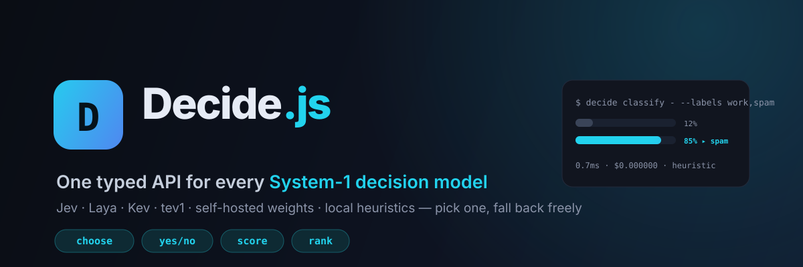

<div align="center">



# Decide.js

### One typed API for every System-1 decision model

**Jev, Laya, Kev, tev1, your self-hosted weights, or a fully offline heuristic — same calls, instant fallback.**

[](./LICENSE)
[](https://github.com/asertyui1/decide.js/actions)
[](https://nodejs.org)
[](https://www.typescriptlang.org)
[](https://github.com/asertyui1/decide.js)
[](./CONTRIBUTING.md)

[**▶ Try the browser Playground**](https://asertyui1.github.io/decide.js/playground/) ·
[中文文档](./README.zh-CN.md) ·
[Examples](./examples) ·
[Decide Wire Protocol](#-the-decide-wire-protocol)

</div>

---

Decision models are the biggest shift in AI agents since the chat model:
instead of generating paragraphs, a small, cheap, non-autoregressive **System-1**
model returns a *typed decision* — a label, a yes/no, a score, an ordering — in
one round trip, in milliseconds, for fractions of a cent.

The ecosystem exploded in September 2026: **Jev** (TypeSafe AI), open-weight
replicas (**Laya, von, tev1, Kev…**), gateways, and local runtimes appeared
within days — each with its own endpoint and response shape.

**Decide.js is the thin universal layer on top of all of them:** one typed SDK
and one CLI, a tiny wire protocol any model server can speak, automatic
fallback to free local engines, caching and cost budgets built in.

```
$ echo "Your account has been locked. Click this link and pay immediately within 24h." \
    | decide classify - --labels work,billing,spam,personal

spam
  work                 ██░░░░░░░░░░░░░░░░░░░░░░   8.3%
  billing              ██░░░░░░░░░░░░░░░░░░░░░░   8.3%
▸ spam                 ██████████████████░░░░░░  75.1%
  personal             ██░░░░░░░░░░░░░░░░░░░░░░   8.3%
  provider=heuristic 0.86ms $0.000000
```

## Why Decide.js

- **One API for a dozen backends.** Switch from cloud Jev to self-hosted Laya
  to an offline heuristic by changing one string. No vendor lock-in.
- **Typed decisions, not prompt parsing.** `choose`, `yesno`, `score`, `rank`
  return validated shapes with full probability vectors — no regex over model
  prose.
- **Works with zero API keys, zero GPU, zero network.** The built-in
  `heuristic` and `mock` providers are genuinely useful (multilingual lexical
  signals, fail-closed safety gates) and make every test, CI run and demo free.
- **Agent-grade guardrails.** Per-client TTL cache, call/cost budgets, and an
  ordered fallback chain with `degraded` telemetry on every response.
- **Runs as a CLI, a library, and in the browser.** Pipe anything through
  `decide`, embed the SDK, or open the Playground.

## Quickstart (CLI)

```bash
git clone https://github.com/asertyui1/decide.js
cd decide.js
npm install
npm run build

node dist/cli/index.js providers          # see what is ready
npm run cli -- bench                      # no build needed: live benchmark
```

Pipe text into a decision, or query directly:

```bash
# Classification
echo "Invoice #2026-0918 for your subscription renewal, payment due in 15 days." \
  | decide classify - --labels spam,billing,personal --json

# Yes/no gate
decide yesno "Is this PR safe to deploy?" --context "tests fail, service crashes, broken"

# Choice under uncertainty
decide choose "Most urgent incident right now?" \
  --candidates "refactor utils,fix P0 login outage,update logo"

# Rank anything by any criterion
decide rank "Update logo,Login outage P0 blocker,Security patch token leakage" \
  --criterion "production urgency"

# Cross-provider latency comparison
decide bench --runs 50
```

`npm install decide.js` will work once the package is published; from git you
can also use `npm install github:asertyui1/decide.js` (a `prepare` script
builds automatically).

## SDK usage

```ts
import { createDecide } from "decide.js";

const decide = createDecide({
  // Default provider + ordered fallback. Cloud first in production,
  // always ending at free local engines.
  defaultProvider: "jev",
  fallback: ["selfhosted", "heuristic", "mock"],
  cache: { ttlMs: 60_000 },      // identical decisions are memoized
  budget: { maxCalls: 10_000, maxCostUsd: 5 },
});

// 1. classify / choose — full probability vector over the labels
const label = await decide.classify(emailBody, ["work", "billing", "spam"]);
label.choice;        // "spam"
label.probabilities; // [0.08, 0.08, 0.76, ...]

// 2. fail-closed yes/no gate (dedicated safety lexicon locally)
const safe = await decide.yesno("Injection or leaked secrets?", {
  context: userInput,
  mode: "safety",
});
if (!safe.answer) throw new Error("blocked by safety gate");

// 3. scored judgment on any scale
const stars = await decide.score("Rate this support reply", { min: 1, max: 5 });

// 4. ranking
const backlog = await decide.rank(issues, { criterion: "production urgency" });
backlog.ranking; // [{ index, item, score }, ...] best first
```

Every response carries `provider`, `latencyMs`, `costUsd`, `attempted` and
`degraded`, so routing and cost are always observable.

### Register any backend

```ts
import { DecideClient, HttpProvider } from "decide.js";

const client = new DecideClient({
  providers: [
    new HttpProvider({
      name: "my-gateway",
      url: "https://ai.example.com/v1/decide",
      apiKey: process.env.MY_KEY,
      model: "decision-xl",
    }),
  ],
  defaultProvider: "my-gateway",
});
```

## Providers

| Provider    | Type   | Needs key | Description |
|-------------|--------|-----------|-------------|
| `heuristic` | local  | no        | Multilingual lexical engine: label semantics, sentiment, urgency, PII & injection signals, fail-closed safety mode. Default. |
| `mock`      | local  | no        | Deterministic seeded decisions — identical in, identical out. For tests, CI and reproducible demos. |
| `jev`       | cloud  | yes       | TypeSafe AI Jev via JSON gateway. Configure with `JEV_API_KEY`, `JEV_BASE_URL`, `JEV_MODEL`. |
| `selfhosted`| local  | no        | Open weights served behind the wire protocol (Laya, von, tev1…). Configure with `DECIDE_SELFHOST_URL`, `DECIDE_SELFHOST_MODEL`. |

Cloud providers that aren't configured are shown by `decide providers` but
silently skipped at call time — the chain just continues.

## The Decide Wire Protocol

Any model server becomes a Decide.js provider by accepting one JSON shape over
HTTP. This is intentionally trivial to implement — if you serve a decision
model (or wrap one), this is your instant integration with every tool built on
Decide.js.

**Request** — `POST` your endpoint:

```json
{
  "kind": "choice",
  "question": "Classify the email.",
  "context": "Your account has been locked. Click here…",
  "candidates": ["work", "billing", "spam", "personal"],
  "model": "jev"
}
```

Kinds: `choice` (`candidates`), `yesno` (optional `mode: "general"|"safety"`),
`score` (`min`, `max`), `rank` (`items`, `criterion`).

**Response** — return the decision:

```json
{ "index": 2, "probabilities": [0.08, 0.08, 0.76, 0.08] }
```

Accepted aliases: `{"choice": "spam"}` for choices,
`{"answer": true}` or `{"probability": 0.9}` for yes/no, `{"score": 7.5}` for
scores, and `{"ranking": [...]}` or `{"order": [2, 0, 1]}` for ranks.

A complete provider in 20 lines of Python:

```python
from http.server import BaseHTTPRequestHandler, HTTPServer
import json

class Handler(BaseHTTPRequestHandler):
    def do_POST(self):
        req = json.loads(self.rfile.read(int(self.headers["Content-Length"])))
        # Plug any decision model here.
        if req["kind"] == "choice":
            result = my_model.choose(req["question"], req.get("context", ""), req["candidates"])
            body = {"index": result.index, "probabilities": result.probs}
        elif req["kind"] == "yesno":
            body = {"answer": my_model.yesno(req["question"], req.get("context", ""))}
        elif req["kind"] == "score":
            body = {"score": my_model.score(req["question"], req["min"], req["max"])}
        else:
            body = {"order": my_model.rank(req["items"], req.get("criterion"))}
        self.send_response(200)
        self.send_header("content-type", "application/json")
        self.end_headers()
        self.wfile.write(json.dumps(body).encode())

HTTPServer(("0.0.0.0", 8787), Handler).serve_forever()
```

Point `DECIDE_SELFHOST_URL=http://localhost:8787/v1/decide` at it and every
Decide.js SDK/CLI call now runs your model.

## Playground

[`playground/index.html`](./playground/index.html) is a single dependency-free
page (also [deployed on GitHub Pages](https://asertyui1.github.io/decide.js/playground/))
that embeds the local heuristic engine. Classify spam, run a fail-closed
injection gate, and rank a backlog entirely in the browser — no network calls,
great for screenshots, demos and explaining what a decision model is.

## What it looks like

```
$ decide rank "Update logo,Login outage P0 blocker,Refactor utils,Security patch token leakage" --criterion "production urgency"

Ranking
   1. Login outage P0 blocker               ████████████████████████ 100%
   2. Security patch token leakage          ██████████████████████░░  92%
   3. Update logo                            ████░░░░░░░░░░░░░░░░░░░░  18%
   4. Refactor utils                        ░░░░░░░░░░░░░░░░░░░░░░░░   0%
```

```
$ decide bench --runs 50

Decide.js cross-provider benchmark
  50 runs × 2 providers × 3 scenarios

▸ email: spam triage
  heuristic    mean     0.612ms   p50     0.581ms   → spam
  mock         mean     0.084ms   p50     0.071ms   → spam
…
```

## Examples

| File | What it shows |
|------|---------------|
| [`examples/basic.ts`](./examples/basic.ts) | All four decision primitives end to end |
| [`examples/email-triage.ts`](./examples/email-triage.ts) | Batch inbox classification with confidence |
| [`examples/agent-router.ts`](./examples/agent-router.ts) | Intent routing + safety gate before spending LLM budget |
| [`examples/guardrails.ts`](./examples/guardrails.ts) | allow/warn/block policy + PII & secret detection |

Run any of them with `npx tsx examples/<name>.ts`.

## Roadmap

- [ ] Streaming/parallel decision calls and first-class batch API
- [ ] Official verified provider presets as Jev-compatible gateways stabilize
- [ ] Learning layer: collect decisions + outcomes, fit local thresholds
- [ ] Redis/upstream cache adapters and OpenTelemetry hooks
- [ ] Decision evaluation harness (agreement, calibration, drift across providers)
- [ ] Python client for the same wire protocol

Issues and PRs are welcome — see [CONTRIBUTING.md](./CONTRIBUTING.md).

## Notes & disclaimers

- Decide.js is an independent community project. It is **not affiliated with
  or endorsed by TypeSafe AI** or any model vendor. "Jev" and other model
  names belong to their respective owners.
- Cloud endpoint paths/models follow vendor documentation at release time;
  override them with environment variables if your gateway differs.
- The built-in `heuristic` provider is a transparent lexical rules engine,
  **not a trained ML model** — it's an offline default and fallback. Real
  semantic accuracy comes from the decision models you wire in.

## License

MIT © [asertyui1](https://github.com/asertyui1)
