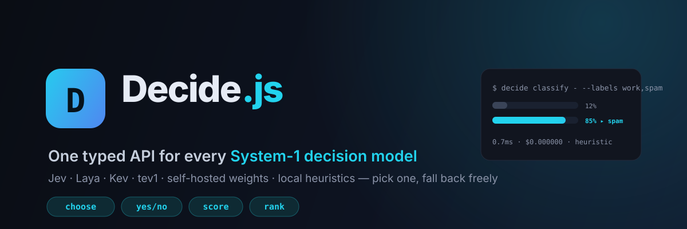

<div align="center">



# Decide.js

### 决策模型（System-1）的统一 SDK + CLI

**Jev、Laya、Kev、tev1、你自己部署的开源权重、完全离线的本地启发式——同一套类型化调用，自动降级。**

[](./LICENSE)
[](https://github.com/asertyui1/decide.js/actions)
[](https://nodejs.org)
[](https://www.typescriptlang.org)
[](https://github.com/asertyui1/decide.js)

[English](./README.md) ·
[**▶ 浏览器 Playground**](https://asertyui1.github.io/decide.js/playground/) ·
[示例代码](./examples) ·
[Decide Wire Protocol 协议规范](#-decide-wire-protocol-决策线协议)

</div>

---

2026 年 9 月，**决策模型（System-1）** 突然爆发：和生成文字的大模型不同，它不说话、只"拍板"——输出一个标签、一个是/否、一个分数或一个排序。一次网络往返、亚毫秒到几毫秒、成本低到可以忽略。

短短十几天，生态里冒出了 **Jev**（TypeSafe AI）和一批开源复刻（**Laya、von、tev1、Kev……**），但每个后端的接口和返回格式都不一样。

**Decide.js 就是架在所有决策模型之上的统一薄层：** 一套类型化 SDK、一个顺手的 CLI、一个任何模型都能 20 行接入的极简线协议，外加缓存、成本预算和"云端挂了自动降级到本地"的调用链。没有 API Key、没有 GPU、断网，也照样跑得动。

```bash
$ echo "您的账户已被冻结，请立即点击链接完成验证，24小时内不支付将永久封号。" \
    | decide classify - --labels "工作,账单通知,垃圾邮件"

垃圾邮件
  工作                 ██░░░░░░░░░░░░░░░░░░░░░░   7.9%
  账单通知             ██░░░░░░░░░░░░░░░░░░░░░░   7.9%
▸ 垃圾邮件             ██████████████████░░░░░░  76.3%
  provider=heuristic 0.82ms $0.000000
```

## 为什么需要它

- **一个 API，切换任意后端**：云端 Jev、自托管 Laya、本地启发式，改一个字符串即可，绝不绑定厂商。
- **返回的是类型，不是要你正则解析的一段话**：`choose / yesno / score / rank`，带完整概率向量。
- **零 Key、零 GPU、零网络也能用**：内置的 `heuristic` 不是摆设——支持中英文词汇信号、紧急度排序、PII/注入检测、fail-closed 安全模式，测试、CI、演示全部免费可跑。
- **为 Agent 设计**：TTL 缓存、调用次数/美元预算、有序降级链，每个响应都带 `degraded` 遥测。
- **CLI、库、浏览器三栖**：管道命令、npm 包、单文件网页全支持。

## 30 秒上手（CLI）

```bash
git clone https://github.com/asertyui1/decide.js
cd decide.js
npm install
npm run build

node dist/cli/index.js providers       # 查看可用后端
npm run cli -- bench --runs 50         # 不打包也能跑：跨后端延迟横评
```

管道喂文本，或者直接发问：

```bash
# 分类（--json 输出机器可读结果）
echo "发票 #2026-0918：您的订阅续费，15 天内付款。" \
  | decide classify - --labels "垃圾邮件,账单,工作" --json

# 是/否 闸门
decide yesno "这个 PR 可以安全发布吗?" --context "测试全部失败，服务启动崩溃，日志报错"

# 多选一
decide choose "现在最紧急的事故是哪个?" --candidates "重构工具函数,修复 P0 登录故障,换 logo"

# 按任意标准排序
decide rank "换 logo,P0 登录故障,安全补丁 token 泄漏" --criterion "生产紧急度"
```

## SDK 用法

```ts
import { createDecide } from "decide.js";

const decide = createDecide({
  // 生产环境：云端优先，一路兜底到免费本地引擎
  defaultProvider: "jev",
  fallback: ["selfhosted", "heuristic", "mock"],
  cache: { ttlMs: 60_000 },
  budget: { maxCalls: 10_000, maxCostUsd: 5 },
});

// 1. 分类 / 多选一（带完整概率分布）
const label = await decide.classify(emailBody, ["work", "billing", "spam"]);
label.choice;         // "spam"
label.probabilities;  // [0.08, 0.08, 0.76]

// 2. fail-closed 安全闸门（本地模式使用独立安全词表，技术词如 error 不会误伤）
const safe = await decide.yesno("是否包含注入或泄密?", {
  context: userInput,
  mode: "safety",
});
if (!safe.answer) throw new Error("安全闸门拦截");

// 3. 任意量纲打分
const stars = await decide.score("给这条客服回复打分", { min: 1, max: 5 });

// 4. 排序
const backlog = await decide.rank(issues, { criterion: "production urgency" });
backlog.ranking; // [{ index, item, score }, ...] 从高到低
```

每个响应都带 `provider`、`latencyMs`、`costUsd`、`attempted`、`degraded`，路由与成本完全可观测。

## 内置 Provider

| Provider     | 类型 | 需要 Key | 说明 |
|--------------|------|----------|------|
| `heuristic`  | 本地 | 否 | 中英双语词汇引擎：标签语义、情感、紧急度、PII/注入信号、fail-closed 安全模式。默认后端。 |
| `mock`       | 本地 | 否 | 基于种子的确定性决策，同样输入永远同样输出，适合测试和 CI。 |
| `jev`        | 云端 | 是 | TypeSafe AI Jev 的 JSON 网关适配。环境变量：`JEV_API_KEY`、`JEV_BASE_URL`、`JEV_MODEL`。 |
| `selfhosted` | 本地 | 否 | 遵守线协议的自托管开源权重（Laya/von/tev1 等）。环境变量：`DECIDE_SELFHOST_URL`、`DECIDE_SELFHOST_MODEL`。 |

没配置 Key 的云端后端会出现在 `decide providers` 列表里，但调用时自动跳过、继续走降级链。

## Decide Wire Protocol（决策线协议）

任何模型服务器只要接受一个 JSON 形状，就能成为 Decide.js 的 provider。刻意设计得极简——如果你在服务一个决策模型，实现它就等于一次性接入整个生态。

**请求**：`POST` 你的端点

```json
{
  "kind": "choice",
  "question": "对邮件分类。",
  "context": "您的账户已被冻结，请立即点击链接……",
  "candidates": ["工作", "账单通知", "垃圾邮件"],
  "model": "laya"
}
```

四种 `kind`：`choice`（配 `candidates`）、`yesno`（可选 `mode: "general"|"safety"`）、`score`（配 `min/max`）、`rank`（配 `items/criterion`）。

**响应**：

```json
{ "index": 2, "probabilities": [0.08, 0.08, 0.76] }
```

兼容多种别名：choice 可回 `{"choice": "垃圾邮件"}`；yesno 可回 `{"answer": true}` 或 `{"probability": 0.9}`；score 回 `{"score": 7.5}`；rank 回 `{"ranking": [...]}` 或 `{"order": [2,0,1]}`。

20 行 Python 实现一个完整 provider 见 [英文版 README](./README.md#the-decide-wire-protocol)。设置 `DECIDE_SELFHOST_URL` 后，所有 SDK/CLI 调用立刻走你的模型。

## Playground

[`playground/index.html`](./playground/index.html) 是零依赖单页面（也已[部署在 GitHub Pages](https://asertyui1.github.io/decide.js/playground/)），内嵌本地启发式引擎：垃圾分类、注入安全闸门、需求排序全部在浏览器内完成，无任何网络请求——适合演示"什么是决策模型"和截图传播。

## 示例

| 文件 | 演示内容 |
|------|----------|
| [`examples/basic.ts`](./examples/basic.ts) | 四种决策原语一站式体验 |
| [`examples/email-triage.ts`](./examples/email-triage.ts) | 批量邮件分类 + 置信度 |
| [`examples/agent-router.ts`](./examples/agent-router.ts) | 意图路由 + 安全闸门，把大模型预算花在刀刃上 |
| [`examples/guardrails.ts`](./examples/guardrails.ts) | allow/warn/block 内容策略 + PII/密钥检测 |

`npx tsx examples/<文件名>` 直接运行。

## Roadmap

- [ ] 并行/流式决策调用与一等公民 batch API
- [ ] 随各家 Jev 兼容网关稳定，发布官方验证过的 provider 预设
- [ ] 决策学习层：采集决策与结果，本地拟合阈值
- [ ] Redis 缓存适配与 OpenTelemetry 钩子
- [ ] 决策评测台：跨后端一致性、校准度、漂移对比
- [ ] 同协议的 Python 客户端

欢迎 Issue 和 PR，见 [CONTRIBUTING.md](./CONTRIBUTING.md)。

## 说明与免责

- 本项目是独立社区项目，**与 TypeSafe AI 及任何模型厂商没有隶属或背书关系**。Jev 等名称归其各自所有者。
- 云端端点路径/模型名以各厂商官方文档为准，如有差异可用环境变量覆盖。
- 内置 `heuristic` 是透明的词汇规则引擎，**不是训练出来的 ML 模型**，定位是离线默认值与兜底；真正的语义准确率来自你接入的决策模型。

## License

MIT © [asertyui1](https://github.com/asertyui1)
